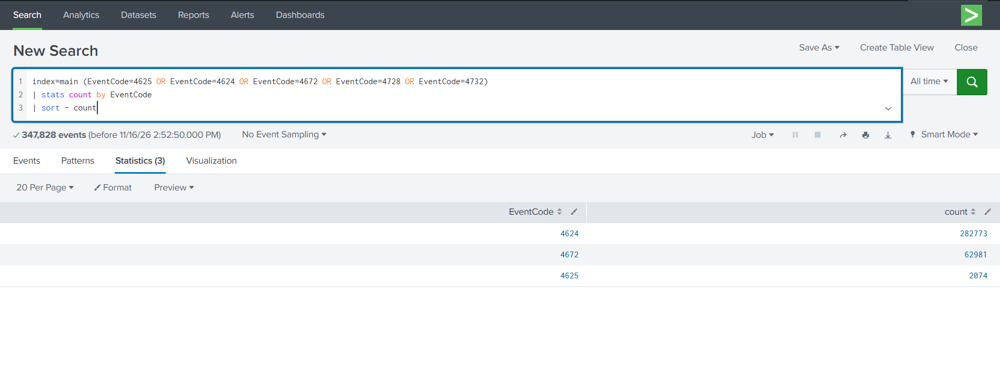
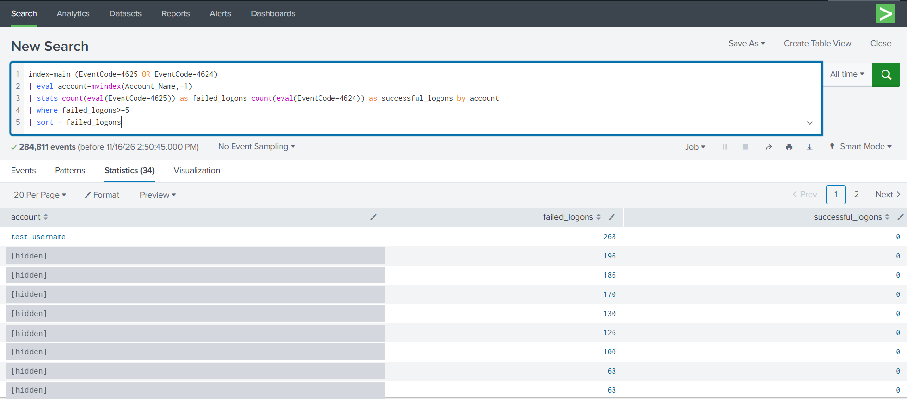
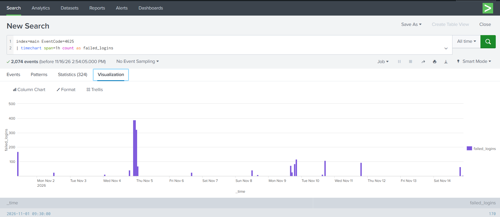
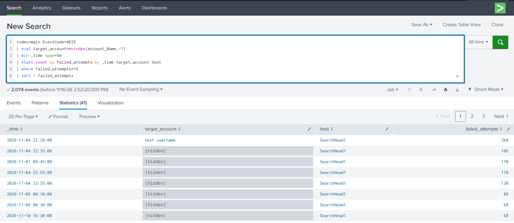
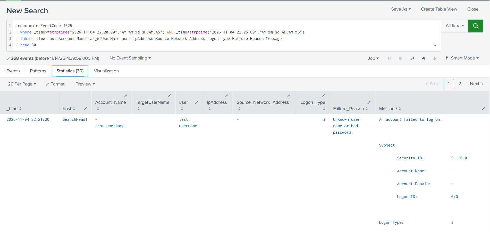
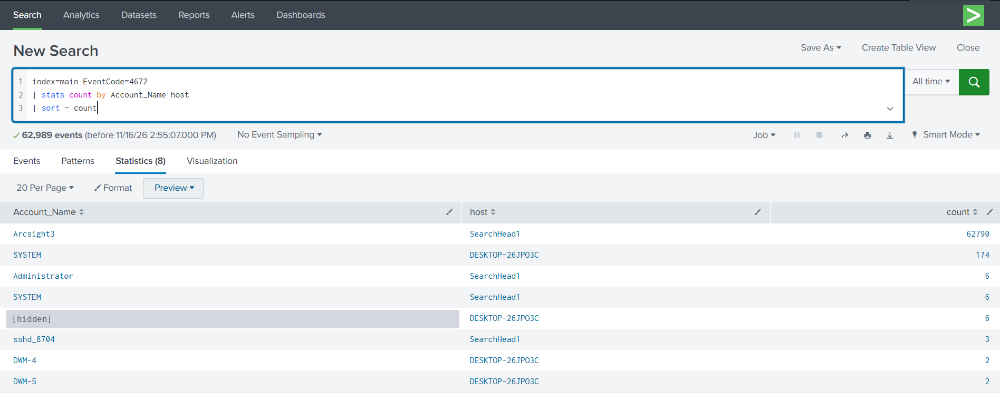
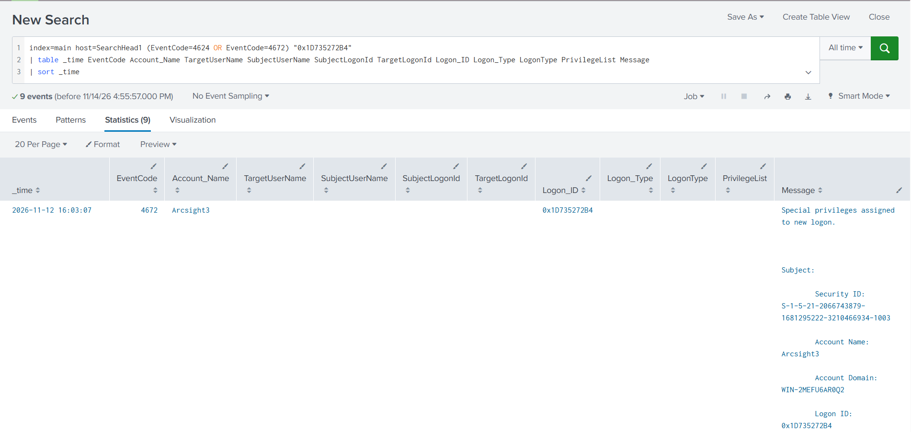
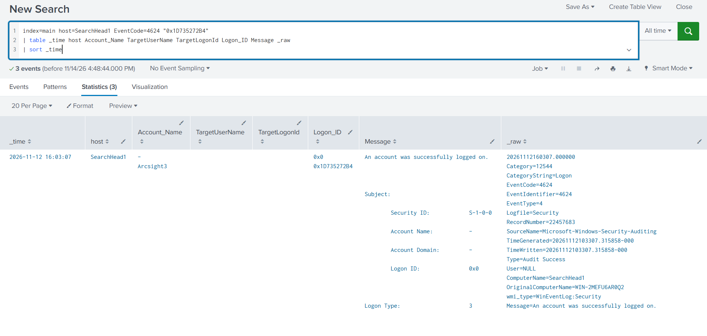

# Windows Authentication Log Investigation: Failed Logons & Privilege Events (Splunk SPL)

## Project Overview

A SOC Analyst L1 portfolio project in which I used Splunk Enterprise and SPL to investigate Windows Security event logs: failed logons (Event ID 4625), successful logons (4624) and special privilege assignments (4672). I measured failed-logon bursts in five-minute windows, checked whether the failing usernames ever logged on successfully, and correlated a successful network logon with a privilege assignment using the Logon ID.

> **Project documents:** [SPL Queries](queries/README.md) · [Investigation Notes](notes/README.md) · [Investigation Report](notes/investigation-report.md) · [Evidence Index](evidence/README.md)
>
> **Dataset and ownership:** The Windows Security event logs were provided in the SIEM Xpert training lab. The investigation, SPL queries, screenshots and documentation are my own work. No raw log files are included in this repository.

## Key Results

Figures come from searches run on 16 Nov 2026 (see `evidence/`).

| Item | Result |
|---|---|
| Failed logons (4625) | **2,074** |
| Successful logons (4624) | **282,773** |
| Special privilege assignments (4672) | **62,981** |
| Account-added-to-privileged-group events (4728 / 4732) | None found |
| Largest failed-logon burst | **268 failures in 5 minutes** (4 Nov 2026, 22:20–22:25) against one username (`test username`, the only account at or above the threshold in that window), host `SearchHead1`; Logon Type 3 in the events inspected |
| Five-minute windows with 5 or more failures | 41 |
| Successful logons for the failing usernames shown (All time search) | 0 |
| Privileged network logon examined | Account `Arcsight3`, Logon ID `0x1D735272B4` (4624 Logon Type 3 matched to a 4672) |

## Analyst Assessment

- **Failed logons:** Many failures within minutes against single usernames, in repeated bursts, is consistent with automated password guessing. None of the usernames shown had a successful logon in the indexed data, so there is no evidence here of a successful compromise. The source address field was empty, so the activity cannot be attributed.
- **Privilege events:** `Arcsight3` accounts for almost all 4672 events and the correlated logon was a network logon (Type 3) with a typical administrative privilege set. This is a preliminary assessment that it looks like routine service or administrative activity. It is not treated as benign until the account owner and its expected activity are validated.
- **Conclusion:** The findings demonstrate investigation and correlation skills. They do not confirm a brute-force attack or malicious privilege escalation, and no security incident is claimed.

## Objectives

- Investigate Windows failed logon events (4625) and successful logons (4624).
- Identify repeated failed-logon activity in short time windows.
- Check whether failing usernames ever logged on successfully.
- Review special privilege assignments (4672).
- Correlate logon and privilege events using Logon IDs.
- Document findings, limitations and next steps.

## Tools and Technologies

- Splunk Enterprise and Splunk Search Processing Language (SPL)
- Windows Security Event Logs (Event IDs 4625, 4624, 4672, 4728, 4732)

## Investigation Workflow

1. Counted events by Event ID to see the overall picture.
2. Compared failed and successful logons per target account.
3. Plotted failed logons per hour to find spikes.
4. Grouped failed logons into five-minute windows (5 or more failures per account and host).
5. Inspected the raw events of the largest burst.
6. Counted 4672 events by account and host.
7. Correlated a 4624 logon with its 4672 event using the same Logon ID.
8. Documented findings and recommended follow-up.

## Evidence

Account names other than the lab accounts were replaced with `[hidden]`.

### 1. Event counts by Event ID

### 2. Failed vs successful logons by account

### 3. Failed logons per hour

### 4. Repeated failed logons in five-minute windows

### 5. Largest burst: 22:20 to 22:25 on 4 Nov 2026

### 6. Special privilege assignments by account and host

### 7. Logon and privilege event correlation by Logon ID

### 8. The matching 4624 logon (Logon Type 3)

## MITRE ATT&CK Mapping

These are possible interpretations of the observed patterns, not confirmed techniques.

| Technique | Possible relevance |
|---|---|
| T1110 Brute Force | Bursts of failed logons against single usernames |
| T1078 Valid Accounts | Possible only: a privileged account logged on successfully; needs validation against expected behaviour |

## Skills Demonstrated

- Splunk searching, filtering and statistics
- Windows authentication event analysis (4625, 4624, 4672)
- Time-based analysis and burst detection (`bin`, `timechart`)
- Multivalue field handling (`mvindex`)
- Event correlation using Logon IDs
- Evidence-based investigation notes

## Limitations

- The dataset comes from a training lab, and results depend on its contents and time range.
- The source network address was not populated in the failed-logon events, so the origin of the activity could not be determined.
- No saved alert or detection rule was built; the five-or-more-failures-in-five-minutes threshold is a starting value that would need tuning in a real environment.
- Event counts can change slightly between searches, possibly because older events were ageing out of the index. The aggregate figures here come from searches run on 16 Nov 2026.
- Event ID 4672 alone does not indicate malicious privilege escalation, and a high number of failed logons does not by itself confirm a brute-force attack.

## Possible Next Steps

- Turn the five-minute failed-logon search into a saved Splunk alert and document the threshold.
- Add an allowlist for known service and administrative accounts.
- Ingest the source address field to attribute failed logons.

## Project Structure

- [queries/README.md](queries/README.md): SPL queries and their purposes
- [notes/README.md](notes/README.md): investigation notes
- [notes/investigation-report.md](notes/investigation-report.md): investigation report and recommendations
- [evidence/README.md](evidence/README.md): sanitised screenshot index
- `evidence/`: sanitised screenshots

## Disclaimer

This is an educational investigation using lab data. It is not a confirmed real-world security incident.
